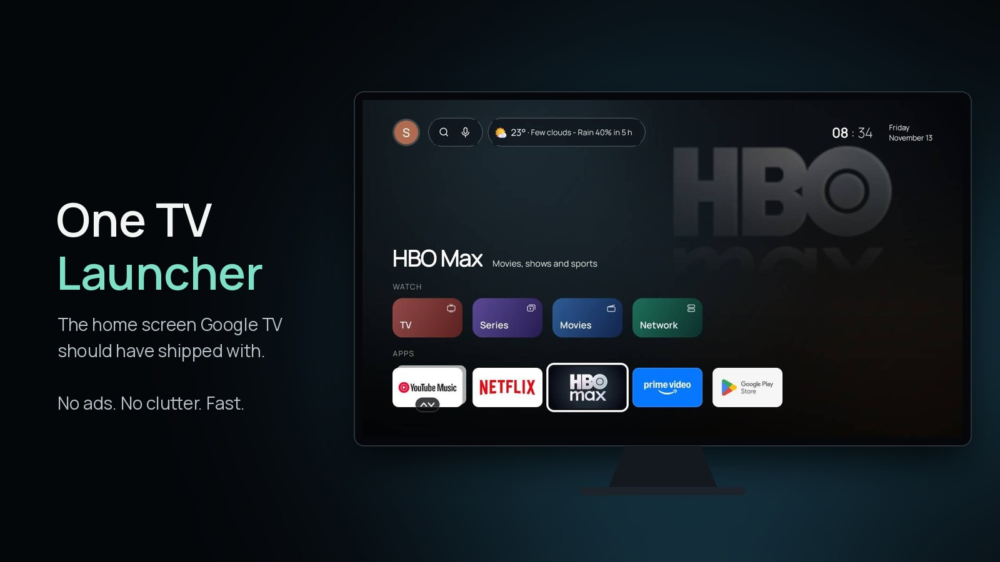
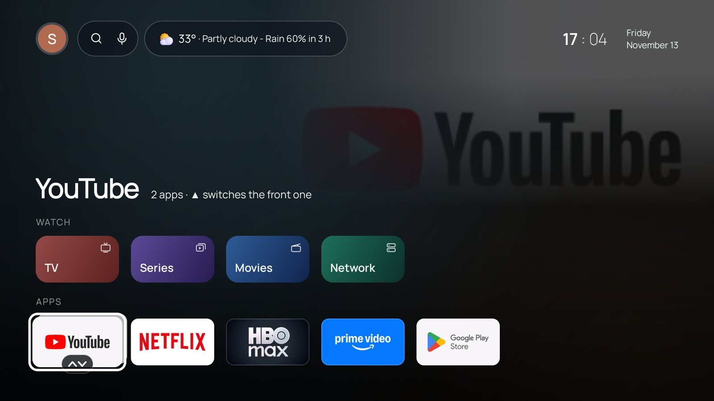
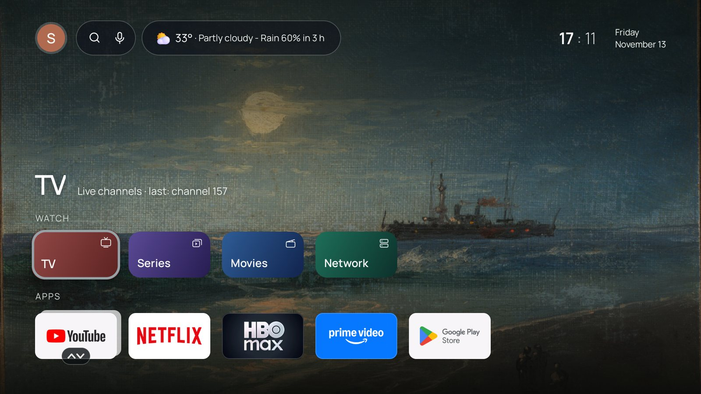
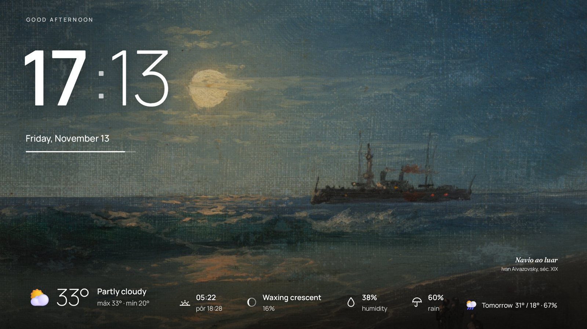
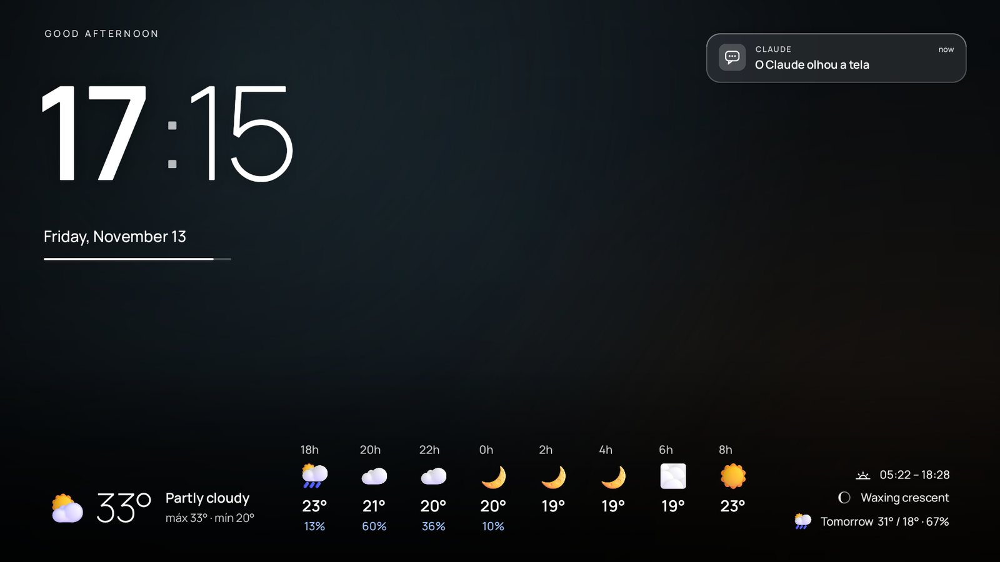
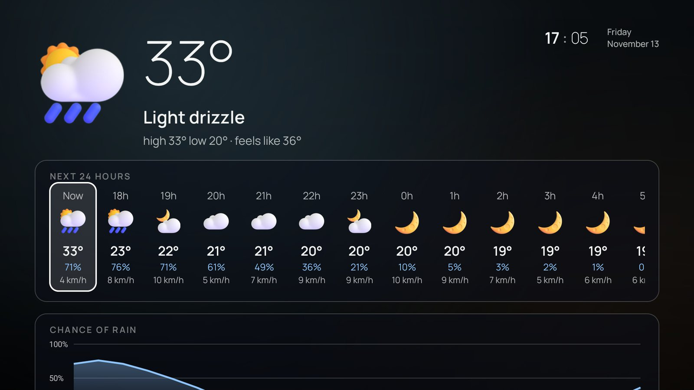
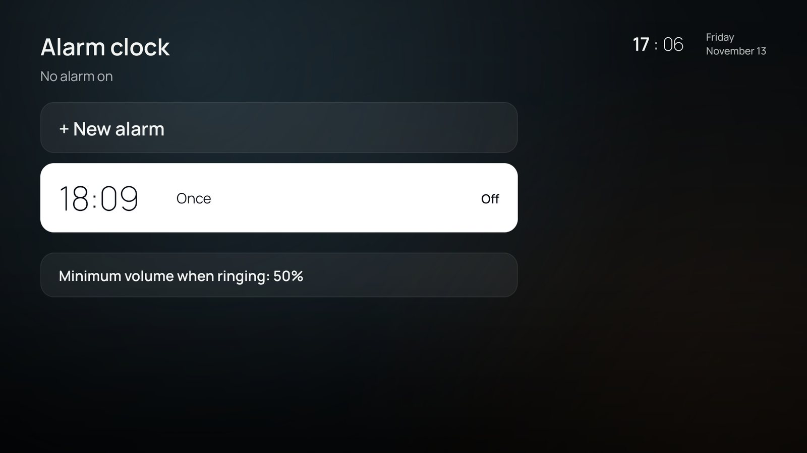
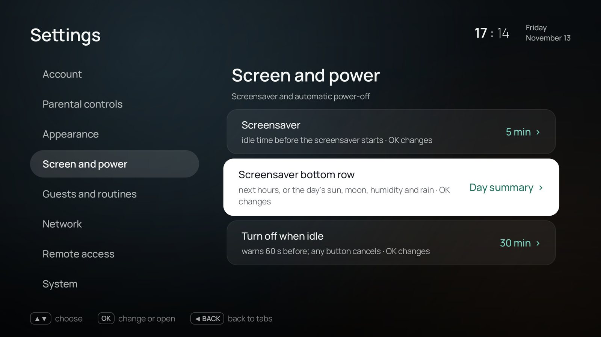

<p align="center">
  
</p>

<h1 align="center">One TV Launcher</h1>

<p align="center">
  <b>A fast, ad-free home screen for Google TV and Android TV.</b><br>
  Your apps, your weather, your alarm clock. No ads or "sponsored" rows.
</p>

<p align="center">
  <a href="../../releases/latest"></a>
  
  
  
  <a href="LICENSE"></a>
</p>

---

The stock Google TV home screen is a billboard with a few apps attached. **One TV Launcher** turns it around: the apps
you actually use come first, and the screen tells you what time it is, whether it will rain, and when your alarm goes
off. It has no ads and no autoplaying trailers, and it doesn't send telemetry anywhere.

It runs every day on a living-room Chromecast with Google TV, so it's built for people sitting on a couch with a
remote, not for a phone with a touchscreen.

## Why you'll like it

| | |
|---|---|
| ⚡ **Fast** | Built with plain Android Views and compiled ahead of time, with no Compose or WebView. Coming back to the home screen takes about 45 ms on a Chromecast (the old version took 73 ms), so it keeps up with the remote. |
| 🧹 **Clean** | Your apps in the order *you* use them. Group apps into stacks, hide the ones you don't want, and turn off the factory bloat. |
| 🌦️ **Weather** | Current conditions from the nearest airport's weather report, plus a rain forecast that combines three weather models. The day/night icon follows the real sunset, twilight included. |
| ⏰ **Alarm clock** | Your TV can wake you up. It turns the TV on over HDMI-CEC, raises the volume gradually, and supports snooze. If the TV was off when an alarm was due, it tells you that alarm was missed. |
| 📺 **TV & movies built in** | Bring your own IPTV account (Xtream Codes or M3U) and get a live channel guide, movies and series with the ratings and synopses you see while browsing, plus Plex, Jellyfin, Emby, SMB, WebDAV and UPnP shares on your network. |
| 🏠 **Smart home** | Home Assistant on your TV: switch lights and scenes with the remote, see the doorbell camera on screen, and let the TV tell Home Assistant what's playing. |
| 🔒 **Yours** | Parental PIN, bedtime limits, a guest mode, and encrypted backups protected by your own password. |

## A quick tour

<p align="center">
  <br>
  <sub><b>Home, Dark theme.</b> Your apps first, a search and voice bar, the weather in one line, and the clock.
  YouTube and YouTube Music share one card here: press ▲ to switch which one is in front.</sub>
</p>

<p align="center">
  <br>
  <sub><b>Home, Gallery theme.</b> A public-domain painting from The Met every day, behind the same home screen.</sub>
</p>

### Two themes

| Dark | Gallery |
|---|---|
| A quiet dark background whose art follows the app or title you select (its logo, poster, rating, year and synopsis). | A different masterpiece every day from [The Met Open Access](https://www.metmuseum.org/about-the-met/policies-and-documents/open-access), with its title and artist. The accent color can follow the painting. |

Switch in *Settings → Appearance → Theme*. The screensaver follows the theme you pick.

### A screensaver worth leaving on

<table>
<tr>
<td width="50%"><br><b>Gallery + "Day summary".</b> The painting of the day moves slowly (so nothing burns in), with the time, the date and the weather on top.</td>
<td width="50%"><br><b>Dark + "Next hours".</b> The weather every 2 hours, and a notification card in the corner.</td>
</tr>
</table>

What can appear on it:

- **Greeting, a big clock and the date**, with a thin line under the date that shows how much daylight is left
  (from sunrise to sunset).
- **Bottom row, your choice** (*Settings → Screen and power → Screensaver bottom row*): **Next hours** (temperature and
  chance of rain every 2 hours) or **Day summary** (sunrise and sunset, moon phase, humidity, chance of rain, tomorrow).
- **Cards in the top-right corner:** TV notifications, your next alarm, and messages sent from the web panel, Home
  Assistant or Claude.
- **Family board** *(optional)*: a shopping list, pinned notes ("Dentist Thursday 3 pm") and today's birthdays from
  your Google Calendar.
- **Your own photos** *(optional)*: upload them in the web panel; they stay in a private folder on the TV.
- **Weekly recap** *(optional)*: on Sunday night, a card with the week's screen time per app, internet used and network drops.
- It replaces Google's stock screensaver, which uses about 59 MB more memory.

### Weather that's actually right

<p align="center">
  <br>
  <sub><b>Forecast.</b> Press OK on the weather: the next 24 hours, a rain chart, 9 days, air quality, the sun and the moon.</sub>
</p>

- **Now** comes from the nearest airport's METAR report, so it's measured, not modeled.
- **Chance of rain** is the median of three weather models (ECMWF, ICON and GFS) from [Open-Meteo](https://open-meteo.com).
- The day/night icon follows the real sunrise and sunset where the TV is, plus 20 minutes of twilight.
- Optional rain alert on screen when rain is about to start.

### Your remote, your rules

The launcher has an accessibility service that sees the remote's keys before the system does, so it can give them
better jobs:

| Button | What it does |
|---|---|
| **HOME** | Always comes back to One TV Launcher, even though Google's launcher is still installed. |
| **HOME (hold)** | Opens the **quick panel**: Wi-Fi, Bluetooth, sleep timer, screensaver, audio output, alarm, guest mode, Google Home and notifications. |
| **Netflix / YouTube buttons** | Remap them to **any app**: press to open it, **hold for 3 s** to pick a different app. Your choice is saved. |
| **OK (hold) on an app** | Move it, stack it with another app, or hide it. |
| **OK (hold 2 s) on a poster or channel** | Add it to or remove it from your list. |
| **▲ ▼ on a stack** | Switch which app of the stack is in front. |
| **Microphone** | Still Google Assistant / Gemini. Voice shortcuts also work ("Hey Google, open *Boletim do Tempo*" reads the forecast aloud; others set a reminder or a sleep timer). |

*Settings → System → Extras → Open the key tester* shows every key the TV receives, live, which helps when a remote behaves oddly.

### Ask Claude to run your TV (MCP)

One TV Launcher has a built-in [Model Context Protocol](https://modelcontextprotocol.io) server. Connect it to
[Claude](https://claude.ai) (or any MCP client) and talk to your TV in plain language:

> *"What's on the TV right now?"* · *"Set an alarm for 6:30 on weekdays."* · *"Put the news channel on and lower the volume."*
> · *"Add milk to the shopping list on the TV."* · *"Why is the internet slow on the TV?"* · *"Turn off the living-room lights."*

| Group | Tools |
|---|---|
| See | `estado_tv` (on/asleep, app in front, volume), `ver_tela` (screenshot + on-screen text), `elementos_na_tela`, `sistema`, `erros_recentes` |
| Control | `controle_remoto` (any key), `tocar_elemento`, `digitar_texto`, `abrir` (an app or a link), `midia`, `energia`, `pedir_acoes` (open screens, volume, alarms, guest mode, live channels) |
| Day to day | `clima`, `agenda_hoje`, `despertadores`, `lembretes`, `rotinas`, `mural` (family board), `aviso_na_tv` (show a message), `buscar_tv`, `semana_tv` |
| Apps & files | `apps`, `apps_instalados`, `instalar_apk`, `desinstalar_app`, `atualizar_launcher`, `arquivos`, `baixar_arquivo` |
| Network & home | `diagnostico_rede`, `historico_rede`, `aparelhos_rede`, `aparelhos_tailscale`, `wake_on_lan`, `casa_listar`, `casa_acionar` (Home Assistant) |
| Power user | `executar_shell` (shell commands as `adb shell`; **blocked by default**, can be set to ask on the TV) |

How it's kept safe:

- **Off until you turn it on.** It's reachable from outside only through a [Tailscale](https://tailscale.com) tunnel that
  runs inside the app (userspace, so it doesn't take the TV's VPN slot). Setup shows a QR code on the TV.
- **OAuth 2.1 with PKCE.** You log in with your web-panel PIN or your Google account (any account already on the TV).
- **You choose how much power it has**: ask for OK on the TV, allow, or block, per kind of
  action (new logins, actions, shell, installs). Screenshots are a separate switch, and the TV shows a notice every time Claude looks at the screen.

### Everything else it can do

<details>
<summary><b>Home screen</b></summary>

- Clock, date and weather on a fixed grid, so nothing jumps around.
- Background art follows the app or title you have selected, with its rating, year and synopsis.
- Stacks, hidden apps, a manual order or "most used first", and **automatic stacks** by category.
- **Simple mode** for people who find the remote hard: big cards, and the TV says the app name out loud.
- **Guest mode** hides your profile, calendar and the apps you choose while visitors are around.
- The Google Assistant and Gemini keep working.
</details>

<details>
<summary><b>Clock, alarms & routines</b></summary>



- Alarms with their own sounds, a volume ramp and snooze. The TV turns itself on over HDMI-CEC to ring, and tells you
  if an alarm was missed while it was off.
- Sleep timer with a **gentle shutdown**: in the last 5 minutes the screen dims and the volume goes down.
- **Turn off when idle**: after 30 minutes without a key press it warns you for 60 s, then sleeps.
- Optional **presence** with a UniFi router: when every phone has left the house, the TV goes to sleep.
- Routines at a set time (turn on, open an app, turn off), scenes, reminders and on-screen messages.
- Your Google Calendar on the TV.
</details>

<details>
<summary><b>Live TV, movies & series</b></summary>

- An IPTV player for **your own** Xtream Codes or M3U playlist: a channel guide, catch-up, favorites, and blocking for channels and categories.
- Movies and series with posters, ratings and "continue watching", resuming where you stopped.
- Audio language preference (original + subtitles, or dubbed), remembered per title, and online subtitles from OpenSubtitles.
- Network media from Plex, Jellyfin, Emby, SMB, WebDAV and UPnP/DLNA.
- One TV Launcher doesn't come with any channels or content.
</details>

<details>
<summary><b>Family & parental controls</b></summary>

- Parental PIN with locked channels and a **kids mode** for Live TV, Movies and Series.
- **Bedtime**: during the hours you choose, only the apps on a list open and the volume has a ceiling.
- Optional PIN to change the home screen.
</details>

<details>
<summary><b>Control from your phone or PC</b></summary>

- **Web panel** on your home network (`http://<tv-ip>:8080`), protected by a PIN: install and remove apps, manage
  permissions, transfer files, see the TV screen live, press remote keys, type text, edit the family board, upload
  screensaver photos, and download or restore encrypted backups.
- Wake-on-LAN for your PC.
</details>

<details>
<summary><b>Smart home (Home Assistant)</b></summary>



- Turn lights, plugs, fans, covers, scenes and scripts on or off from the couch (the **Home** tile in the quick panel), from the web panel, or by asking Claude.
- The TV reports itself to Home Assistant (`sensor.tv_<name>`: on or asleep, the app in front, what's playing), so automations like "movie paused → dim the lights" are easy.
- When the doorbell rings, the camera snapshot pops up over whatever you're watching.
- Talks directly to your server on your network, with no cloud in between. The token is encrypted on the TV. Setup: [docs/home-assistant.md](docs/home-assistant.md).
</details>

<details>
<summary><b>Network & privacy</b></summary>

- Private DNS (DNS over TLS) picker, with an automatic rollback if the new server doesn't answer.
- A per-app DNS log and internet usage per app, kept on the TV for 7 days.
- Wi-Fi quality colored by signal, latency and link speed. One-tap speed test.
- Night filter: a warmer, dimmer screen in the evening.
- No analytics and no tracking. Crash reports stay on the TV unless *you* send them.
</details>

<details>
<summary><b>Takes care of itself</b></summary>

- Overnight maintenance: clears caches, repairs permissions and keeps alarms scheduled.
- Automatic, encrypted backup every night (PBKDF2 + AES-GCM, with your password).
- Updates itself from GitHub Releases. Only APKs signed with the project key are accepted.
- System updates install only at night (3 to 5 am), so they don't interrupt a movie.
- Re-applies the bloat cleanup after a system update, and can lock "Force stop" and "Clear data" on itself.
</details>

## Install

You need a **Google TV / Android TV** device. It's tested daily on a Chromecast with Google TV (Android 14). Download the APK from
[**Releases**](../../releases/latest):

| File | For |
|---|---|
| `one-tv-launcher.apk` | 32-bit devices (`armeabi-v7a`), e.g. **Chromecast with Google TV** |
| `one-tv-launcher-arm64.apk` | 64-bit devices (`arm64-v8a`) |

### Install with Downloader (no computer needed)

1. Install **Downloader** by AFTVnews from the Play Store on your TV.
2. Open it and enter the code **`8887571`** (or the short link [`aftv.news/8887571`](https://aftv.news/8887571)). It downloads
   `one-tv-launcher.apk` (32-bit, Chromecast with Google TV).
3. Tap **Install**.

On a 64-bit TV, type this address in Downloader instead:
`https://github.com/ChrnX0/one-tv-launcher/releases/latest/download/one-tv-launcher-arm64.apk`

### Then

1. **Install the APK** with Downloader (above), any other sideloading app, or `adb install one-tv-launcher.apk`.
2. **Open it.** A welcome wizard walks you through each step with the remote. You don't need a computer:
   1. Turn on the launcher's remote-key service (accessibility).
   2. Turn on Developer options. The wizard shows you where.
   3. Pair the launcher with the TV. It reads the pairing code from the screen for you.
   4. *(Optional)* Make it the **device owner**. This lets it pin the HOME button, hide apps and protect itself from
      "Force stop".
3. Press **HOME**. Done.

> [!IMPORTANT]
> **The device owner step is optional, and only a factory reset undoes it.** Google turns off for a few seconds while
> it's applied; your Google account stays, but any extra user profiles on the TV are removed. Everything else works
> without it. Details: [docs/device-owner.md](docs/device-owner.md).

> [!NOTE]
> Google's own launcher stays installed. Gemini, voice search results and Google's notifications panel live inside it.
> One TV Launcher keeps HOME for itself and lets Google handle the rest.

## Build it yourself

```bash
git clone https://github.com/ChrnX0/one-tv-launcher.git
cd one-tv-launcher
cp pessoal.properties.exemplo pessoal.properties   # optional: your city, coordinates and favorite apps
./gradlew assembleRelease                           # JDK 21 + Android SDK 36
```

- Kotlin 2.2, AGP 8.11, Gradle 8.14. Views only, with no XML layouts and no Compose.
- The Tailscale tunnel (`tunel/`, Go) is built into the APK if Go is installed. Without Go, the APK is built without it.
- Unit tests run on the plain JVM: `./gradlew testReleaseUnitTest`.
- Release builds are signed with `ASSINATURA_ARQUIVO` / `ASSINATURA_SENHA` / `ASSINATURA_ALIAS`. Without them, Gradle uses the debug key.

> The code comments are in Brazilian Portuguese, and the app speaks both **English** and **Portuguese**. It follows the
> TV's language.

## Under the hood

```
app/src/main/kotlin/…/
├─ MainActivity, Grade, DesenhoHome   home screen and its fixed grid
├─ PrivilegioDO, VirarDono            device owner: hide apps, pin HOME, permissions
├─ AdbConnectionManager, Guardiao…    built-in ADB client: the TV pairs with itself (no PC, no Shizuku)
├─ AutorizaShizukuService             accessibility: remote keys, HOME long-press, window watcher
├─ Player*, Vod*, Plex, Jellyfin…     IPTV, movies, series and network media
├─ Painel*                            web panel (HTTP server, PIN, PBKDF2, rate limiting)
├─ Mcp*, TunelTailscale               MCP server + Tailscale tunnel (userspace, no VPN slot used)
└─ Despertador, Protetor*, Previsao…  alarm clock, screensaver, weather
```

Security was designed in from the start. The web panel only answers on the local network, checks the Host and Origin
headers, uses HttpOnly cookies, and asks for the PIN again before anything destructive. MCP uses OAuth 2.1 with PKCE.
Secrets are encrypted with the Android Keystore. Backups are encrypted with your password.

## Contributing

Bug reports, ideas and pull requests are welcome: see [CONTRIBUTING.md](CONTRIBUTING.md). Found a security problem?
Please report it privately, as described in [SECURITY.md](SECURITY.md). What changed in each version: [CHANGELOG.md](CHANGELOG.md).

## License

One TV Launcher is free software, released under the [GNU General Public License v3.0](LICENSE). You can use, study,
change and share it; if you distribute a modified version, you must publish its source under the same license.
Third-party code keeps its own license (see Credits below).

## Credits

The fonts, icons, libraries and data sources all come with their licenses in
[`app/src/main/assets/licencas.txt`](app/src/main/assets/licencas.txt). You can also read them on the TV in
*Settings → Licenses*. The weather data comes from [Open-Meteo](https://open-meteo.com) and METAR reports, and the paintings come from
[The Met Open Access](https://www.metmuseum.org/about-the-met/policies-and-documents/open-access).

---

<p align="center"><sub>Not affiliated with Google. "Google TV", "Android TV" and "Chromecast" are trademarks of Google LLC.</sub></p>
