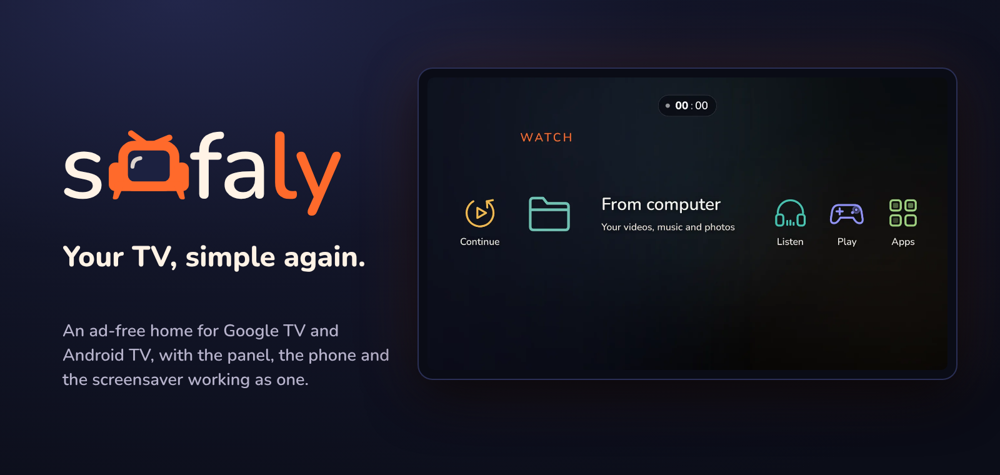
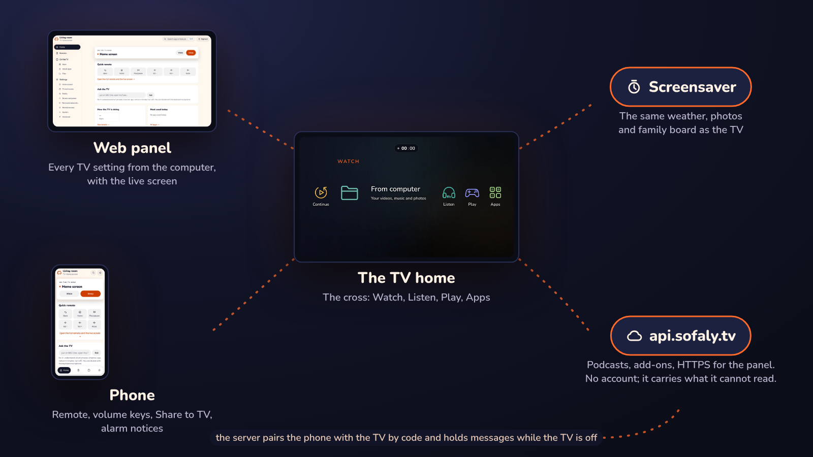
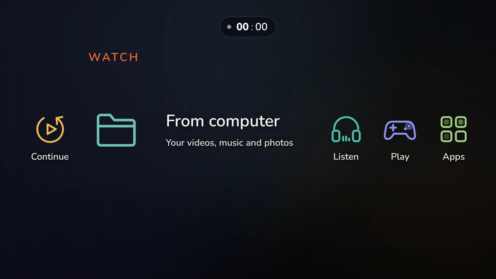
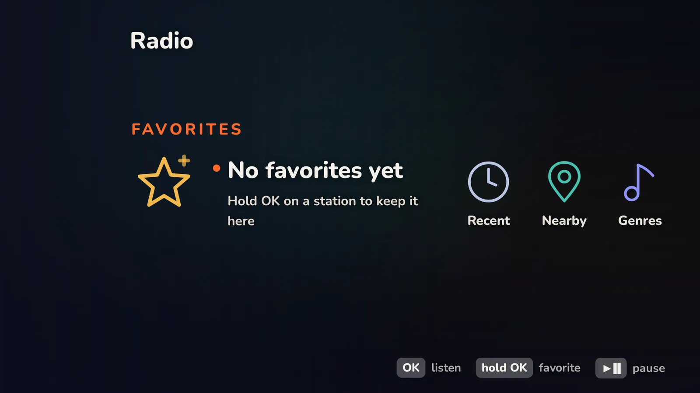
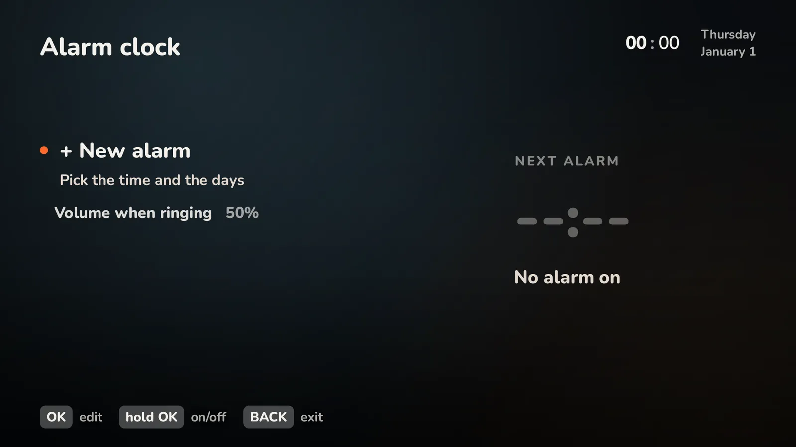
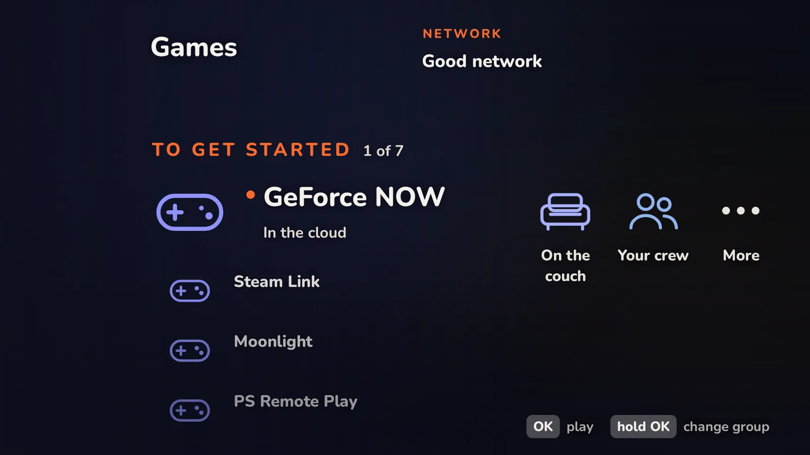
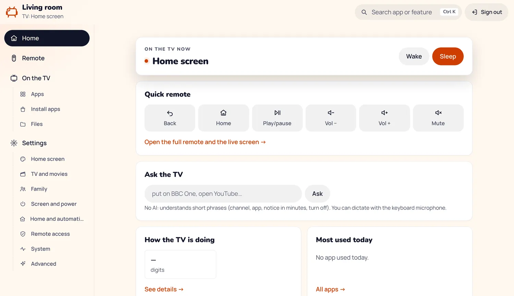
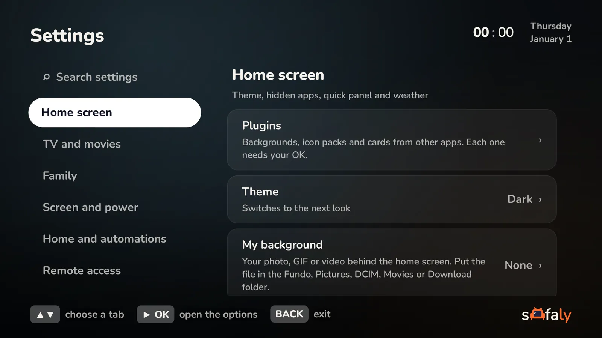

  

  
  

  <a href="https://sofaly.tv"><b>sofaly.tv</b></a> ·
  <a href="#install">Install</a> ·
  <a href="#what-changed-in-this-version">What changed</a> ·
  <a href="#every-feature">Every feature</a> ·
  <a href="https://sofaly.tv/help.html">Help</a>

---

**Why.** The stock Google TV home is a billboard with a few apps attached: rows of ads, trailers that play by
themselves, and the app you wanted three rows down.

**What for.** Sofaly puts the house back in charge. One tidy screen anyone in the family understands, the right
weather and an alarm that turns the TV on, and a phone and a computer that can do everything the remote can.

**How.** Sofaly replaces the home screen of a Google TV or Android TV. It doesn't show ads, doesn't need an account and
doesn't send telemetry. It runs every day on a living-room Chromecast with Google TV, so it's built for a couch and a
remote, with large type for people who don't like small print.

## How it fits together

Sofaly is five parts that share one memory. Change a setting in the panel and the TV has it; the screensaver shows
the same weather and photos as the home screen; the phone gets the alarm the TV just rang.

  

| Part | Why it exists | What you get | How it connects |
|---|---|---|---|
| **TV home** | Google's home puts ads first. | *The cross*: Continue, Watch, Listen, Play and Apps in one row, with what's inside right below. | Everything else feeds it: settings, weather, photos, reminders. |
| **Screensaver** | An idle TV is a black rectangle. | Clock, weather, your photos and the family board. In the morning a summary of the day, late at night dark and warm. | Uses the home screen's weather, photos and reminders. |
| **Web panel** | Settings with a remote are slow. | Every TV setting from a computer or phone browser, the live screen, files, backups. PIN-protected, home network only. | Same settings as the TV. A change shows up on the TV at once, with Undo. |
| **Phone app** | The remote is always lost. | Remote with touch and typing, volume keys, *Share to TV*, a notice when the TV alarm rings. | Finds the TVs at home and opens the panel with a pinned certificate. |
| **api.sofaly.tv** | Some things can't live on the TV. | Podcasts, add-ons, a trusted HTTPS name for the panel, pairing the phone with the TV by code. | No account: each device is a key pair, and messages are sealed so the server can't read them. Sofaly keeps working if it's down. |

## On your TV

<table>
  <tr>
    <td width="50%"> <b>The cross.</b> Pick a world with ◀ ▶; what's inside opens right below.</td>
    <td width="50%"> <b>Listen.</b> Radio and podcasts with the same care as video.</td>
  </tr>
  <tr>
    <td> <b>Wake up.</b> The alarm turns the TV on and raises the volume slowly.</td>
    <td> <b>Play.</b> All your games in one place, ready for the controller.</td>
  </tr>
  <tr>
    <td> <b>Web panel.</b> What's on the TV now, quick remote and every setting.</td>
    <td> <b>Settings.</b> The same groups as the panel, with an index at the top.</td>
  </tr>
</table>

These are the same pictures as sofaly.tv, so both pages change together.

## Install

You need a **Google TV / Android TV** device (Android 10 or newer). It's tested every day on a Chromecast with Google
TV (Android 14). Download the APK from [**Releases**](../../releases/latest) or [sofaly.tv](https://sofaly.tv):

| File | For |
|---|---|
| `sofaly-launcher.apk` | 32-bit devices (`armeabi-v7a`), e.g. **Chromecast with Google TV** |
| `sofaly-launcher-arm64.apk` | 64-bit devices (`arm64-v8a`) |

Already installed? Sofaly updates itself from here.

### Install with Downloader (no computer needed)

1. Install **Downloader** by AFTVnews from the Play Store on your TV.
2. Open it and enter the code **`6566820`** (or the short link [`aftv.news/6566820`](https://aftv.news/6566820)). It downloads
   `sofaly-launcher.apk` (32-bit, Chromecast with Google TV).
3. Tap **Install**.

On a 64-bit TV, type this address in Downloader instead:
`sofaly.tv/download-arm64`

### Then

1. **Install the APK** with Downloader (above), any other sideloading app, or `adb install sofaly-launcher.apk`.
2. **Open it.** A welcome wizard walks you through each step with the remote. You don't need a computer:
   1. Turn on the launcher's remote-key service (accessibility).
   2. Turn on Developer options. The wizard shows you where.
   3. Pair the launcher with the TV. It reads the pairing code from the screen for you.
   4. *(Optional)* Make it the **device owner**. This lets it pin the HOME button, hide apps and protect itself from
      "Force stop".
3. Press **HOME**. Done.

> [!IMPORTANT]
> **The device owner step is optional, and only a factory reset undoes it.** Google turns off for a few seconds while
> it's applied; your Google account stays, but any extra user profiles on the TV are removed. Everything else works
> without it. Details: [docs/device-owner.md](docs/device-owner.md).

> [!NOTE]
> Google's own launcher stays installed. Gemini, voice search results and Google's notifications panel live inside it.
> Sofaly keeps HOME for itself and lets Google handle the rest.

## What changed in this version

The same list the TV shows in *Settings → System → What changed*. Older versions: [CHANGELOG.md](CHANGELOG.md) and
[Releases](../../releases).

<!-- auto:changes -->
- Web panel with the Sofaly look: each area has its color on the icon, the Home page shows Sofy's notes, what is on the TV now and the worlds as doors, and nothing went missing
- Panel: a star on any block or switch adds it to “Your shortcuts” on the Home page, “Works with” links related blocks, and a change offers Undo
- Panel: new Sofy tab (today's notes, why she did it, Undo for frozen apps) and Apps with Frozen and Hidden shelves (Hidden asks for the PIN)
- TV Settings like the panel: long tabs have an “On this page” index at the top, and “Works with” pills take you to the related group
- Alarm clock: when the LG wakes up still on yesterday's loud volume, the alarm no longer starts loud
- Series: “Next episode” shows up when the credits start, “Skip recap” works like “Skip intro”, the bar says when the video ends, and ⏮ (or ▼ › Subtitles) replays the last 10 s with subtitles
- LG TV volume from the panel and the assistant: the volume and mute keys now really change the sound (they went to the HDMI output, which stays locked at maximum)
- Your phone becomes a remote: in the Sofaly phone app, tap the TV to swipe, tap and type; volume and ⏯ also in the notification and the quick settings tile
- Alarm rang on the TV: the phone with the panel installed gets a notice
- In the panel on a computer, drag a video, song or photo onto the page and watch it on the TV
- A screensaver that follows the day: in the morning it shows the day's summary, at night it gets softer and late at night it turns dark and warm, without the logo
- Search: you can speak instead of typing, and your last searches come first
- Empty screens show the mascot, what happened and what to do; a film with no poster gets its own colour instead of grey
- Remote hints at the bottom go away after you have seen them 3 times on each screen
- Text of at least 15 in the top bar and badges; the podcast player reads the focused button aloud
- Panel: 48 px buttons on phones, the chosen filter marked with the orange bar, stronger contrast for faint text
- Podcasts and radio: holding OK no longer pauses and resumes on its own, the PLAY and PAUSE keys do only what they say, and the remote's volume works inside the podcast player
- Movies and Series: switching between dubbed and subtitled continues from where you were; titles without a synopsis no longer show the word “null”
- Home (HA): the TV only talks to the Home Assistant it already knows; the podcast sleep timer no longer turns the radio off
- An update installed while the TV sleeps is now optimised that same night (before, the new version ran slower all the next day, until the screen turned off again)
- Movies and Series open faster: joining the dubbed and subtitled copies of each title now takes a fraction of the time (on big lists it kept the TV busy for over a minute after opening)
- Home screen: moving along the cross is lighter, because the faded items no longer need an extra drawing pass on every frame
- Reading the focused item aloud (Extras): closed screens no longer stay stuck in memory
- Player (movies, series, files and live TV): the ▼ menu is simpler. The first screen has Audio, Subtitles, Watch dubbed/subtitled, Picture and sound, More options; the current value shows on the right, › opens the next list, ✓ only marks what is chosen, and BACK goes to the list above
- Movies and Series: no more key hints along the bottom, so the posters get the space; the poster shows only the progress bar (the time left is in the box at the top), and labels never take two lines
- Settings: turning on high contrast (or changing the text size or a ready-made look) keeps the focus on the same option, and changing an option no longer shows the “Undo” notice that took the focus away (undo stays in System › Recent changes)
- New app name on the TV (tv.sofaly.launcher): settings, add-ons, plugins and the panel move over by themselves, with no reset
- One colour system: orange only marks the brand, the focus and progress; secondary text in soft white; every world keeps its own colour and drawing in every top-bar style
- Movies and Series get the same blue background as the home screen; “On the network” is now “From the computer”, with a folder icon
- High contrast for real: solid black background, columns at full strength; app menu with “Uninstall” set apart at the end; Diagnostics without the repeated summary; Home (HA) offline shows “Try again”
- Screens on one standard: Radio, Games, Alarm, Movies and Series titles in the same size and place; the remote hints look the same on every screen; empty Movies and Series show “Add a list”; menus without the “1 of 5”
- Clearer text: “Season 1, episode 2”, “Continue from 19 min” on the movie page, Extras in sections, the Scoreboard without a repeated line
- Errors with a way out: without network, the phone and move-from-another-TV screens show “Try again”; so does the Forecast with no data; in Diagnostics, a failing Wi-Fi opens Wi-Fi settings
- Help: the QR moved out of the clock corner to beside the text; an app’s menu covers the home screen behind it better
- The LG now turns off together when the Chromecast falls asleep on its own after sitting idle (it refused the HDMI turn-off command)
- All apps: the same header as the Radio and Games screens, with “In the grid: X · hidden: Y”; wallpaper plugins no longer show as apps
- Radio, Podcasts and Games: the list name sits right above the first item; the “Live” card leaves when the focused station is the one playing
- Bigger letters (nothing below 15) in settings, footer keys, the corner date and lists
- Phone and computer panel with the colours and fonts of the sofaly.tv website
- The new-device-on-network alert no longer repeats for the same phone; the focused button in the podcast player is clearly visible
- Series: the same two full rows of posters as Movies, with a SUB badge; the box at the top is one line (no plot) and lines up with the box on the left; long titles are shortened so the rating and year always show
- Movies and Series: your Trakt and MDBList lists now scroll with the categories, in alphabetical order; in Movies you can also pick a list in the Filter
- Movies: two full rows of posters fit on screen (6 per row on a typical TV); the title shows large at the top, and subtitled-only copies get a SUB badge
- Movies: dubbed and subtitled copies of the same film now show as one card (the details page has both versions)
- Movie and series details now come from Trakt: plot in your language, director, cast, trailer and the next episode
- Weather: forecast from MET Norway; the city or postal code is found on the TV itself, no outside service
- Simkl: connect your own account to see the community rating; the details page invites you to connect
- Top bar (Ilha): up to 3 things take turns, small status icons next to the clock, and the dot turns amber or red when something needs attention
- What just arrived (doorbell, reminder, appointment, alarm) grows under the pill for a few seconds; hold ▲ to open the quick panel
- TV in Continue: “On air” no longer disappears when the TV goes all day without opening the player (the home screen fetches the guide by itself)
- Continue: each item says what it is (TV, Series, Movie, Radio, Podcast, Game or the app), like the other categories; the title is below and the rest in the corner
- Alarm clock: the sound always starts low and rises slowly, over at least a minute and a half, even with “Ring: direct”, so it never starts at full volume
<!-- /auto:changes -->

## Every feature

<!-- auto:features -->
**121 features in 12 areas**, the same list as [sofaly.tv](https://sofaly.tv/#mundos). Open an area to see each one and where to find it on the TV.

<b>The cross</b> · A tidy screen anyone understands, arranged the way you like. (19)

- **The cross.** Continue, Watch, Listen, Play and Apps in one row. The world you pick grows big, with what's inside right below it. ◀ ▶ switch worlds, ▲ ▼ go down the column, OK opens.
- **Continue.** One place to get back to what you were doing: the episode, the station, the podcast or the last app. It's the first item of the cross.
- **Top bar.** Search, voice, the weather in one line and the clock, always in the same place. It folds away while you browse so the screen can breathe. Go up to it with ▲.
- **Google keeps working.** The Google Assistant, Gemini, search and your Google account work as before. Sofaly changes the home screen, not your TV. Use the microphone button as always.
- **Quick panel.** Wi-Fi, Bluetooth, sleep timer, sound output, alarm, profiles, notifications and the shopping list, from any app. Hold BACK.
- **Your remote, your rules.** HOME always comes back to Sofaly. Holding BACK opens the quick panel, holding HOME opens the House, and holding OK on an app opens its menu. A key tester shows every button the TV receives.
- **Now playing.** A pill at the top with the cover and title of what's playing. OK pauses or resumes, holding OK opens the app. Turn it on in Home screen › More options.
- **Themes and backgrounds.** Dark, with the art of what's in focus. Gallery, with a painting from The Met every day. Sky, with satellite and map. Or a background of your own, photo or video. Plugin backgrounds work too, like the aerial footage from Overflight. Dark, Gallery and Sky in Basic; the others in Pro.
- **Icons you like.** Use an icon pack from Play or change a single app's icon, one by one. Hold OK on the app › Change icon.
- **Animations that fit your TV.** Strong TVs animate everything; simpler ones animate only what you picked and slow down by themselves when frames drop. Settings › Appearance.
- **Moon phase.** Tonight's moon and how much of it is lit, worked out on the TV itself, with no internet. In the forecast, on the screensaver and on the weather icon at night. Settings › Appearance.
- **Countdown.** How many days are left until the date you pick, or until the next holiday. In the pill at the top of the screen. Settings › Appearance.
- **House reminder.** A note that comes back on the weekdays you choose: recycling day, medicine, a class. In the pill at the top of the screen. Settings › Appearance.
- **Your service's status.** The TV checks an address you give it and shows whether it's up: the home server, the shop's website. In the pill at the top of the screen. Settings › Appearance.
- **Today's rates.** Currencies, bitcoin and ether at today's value, from open official sources. Next to the weather, in the top bar. Settings › Appearance.
- **Your team's next match.** When and against whom your team plays next, on a card on the home screen. In the TV item of the cross. Settings › Appearance.
- **Cards from other apps.** Besides Sofaly's own cards, partner apps put theirs on the home screen: the delivery order, the bus, the notice from the building. Cards show at the end of Watch.
- **The Island at the top of the screen.** Notices take turns in a pill at the top: no internet, reminder, calendar and alarm. What matters grows for 5 seconds with “▲ to open”, the Home doorbell shows up right away and, when you turn on the TV, a summary of what happened appears. Hold ▲ at the top of the cross to open the Hub. Home screen, at the top.
- **The right suggestion at the right time.** No artificial intelligence: from the week's use, the TV suggests what makes sense at that hour. Home screen.

<b>Watch</b> · Your movies, your series and a home-theater player. (14)

- **From computer.** Videos, music and photos from Plex, Jellyfin, Emby, PC or NAS folders (SMB, WebDAV, FTP, SFTP, NFS), OneDrive, Dropbox, Box, Google Drive, UPnP and USB drives. Servers that are on and USB drives show up by themselves; the rest go in Add.
- **A player that plays everything.** Dolby (AC3, E-AC3), DTS and TrueHD sound, and Blu-ray, DVD and anime subtitles, without installing Kodi or VLC. Press ▼ during a video for audio, subtitles and subtitle size.
- **Picks up where you stopped.** Movies and episodes come back at the right spot. The next episode starts after 10 seconds, and after 3 in a row the TV asks if you're still watching. Works by itself.
- **Skip intro.** When a series' intro is known, “Skip intro · OK” shows up. You can also mark the intro once and the TV remembers. On out of the box.
- **Preferred audio and subtitles.** Original with subtitles or dubbed, chosen once and remembered per title. Subtitles from the internet when the file has none. TV and movies › Audio and subtitles.
- **Movies without judder.** The TV switches to 24 Hz while a movie plays, so camera pans stay smooth. Turns on with the movie; the screen blinks black for a second.
- **See and hear better.** Subtitles on a black box or in yellow, “Clearer voice” that brings out speech, and “Even volume” that tames loud movies and lifts quiet ones. In the player's ▼ menu.
- **Automatic subtitles.** When there's no subtitle in your language, the TV translates the one there is. Pick it in the player's subtitle menu.
- **Full movie pages.** Poster, rating, cast, trailer, age rating and the movie's collection on a beautiful page, in large text. With “Who is that actor?”: photo, character and other work. OK on a movie or series.
- **Your Trakt and Simkl lists.** What you want to watch and what you've watched, synced with your account and your other devices. Sign in with the QR in TV and movies › Services.
- **One search for everything.** Finds movies, series, stations and apps at once, and carries the same search to YouTube, Netflix or Prime Video. In the top bar, or by voice.
- **Two subtitles at once.** For example, your language at the bottom and the original on top, to learn or to watch together. Player ▼ menu › Subtitles.
- **Louder dialogue.** When 5.1 sound becomes stereo, speech stays in front and explosions don't drown out voices. Player ▼ menu.
- **No spoilers and a second language.** The summary of an episode you haven't seen stays hidden. No audio or subtitles in your language? The second one you chose comes in.

<b>Listen</b> · Radio and podcasts with the same care as video. (5)

- **Radio from all over the world.** Thousands of open radio stations, by name, country or genre, with your favorites and the last ones you played. Listen › Radio.
- **Podcasts.** Subscribe by name, listen on the TV and pick the episode up where you stopped. Listen › Podcasts.
- **Discover podcasts.** Search the whole open podcast catalog and see what's trending in your country. Listen › Podcasts › Search.
- **Full-screen player.** Big cover, chapters, speed and a sleep timer that pauses at the end of the episode. Listen › Now playing › Open the player.
- **Sound in your headphones.** The movie's sound goes to your phone's headphones, in sync, to watch at night without waking anyone. Player ▼ menu › Sound on phone.

<b>Play</b> · All your games in one place, ready for the controller. (6)

- **All your games in one place.** GeForce NOW, Steam Link, Moonlight, PS Remote Play, RetroArch and the TV's games leave the apps row and live in Play, grouped into Cloud, From the PC, Retro and On the TV. Hold OK on a game to change its group.
- **Play on the PC upstairs.** The TV wakes the computer over the network, waits for it to answer and opens Moonlight or Steam Link. Waking the PC over the network also works outside Play, from a home screen shortcut. Save the computer once in the web panel.
- **Test the network.** Tells you whether your internet can handle cloud gaming, and warns before opening a cloud game on a weak network. Play › Test the network.
- **Game controllers.** Pair a controller without hunting for menus, see the connected ones at the top and, if you like, make a connected controller open Play. Play › Pair controller.
- **Game mode.** While a game is open, the screensaver, the night filter and notices wait for the match to end. Turns on by itself.
- **Your Discord crew.** See who from your Discord server is online and in which game, and call the crew right from the TV. Turn on the server widget and paste its number.

<b>Apps</b> · Your apps in an order that makes sense. (3)

- **Your favorites up front.** Apps shows the 8 apps you open most, and “All apps” brings the rest in a grid. Apps, on the cross.
- **Your way.** Move, stack or hide any app. Factory apps you don't use step out of the way. Hold OK on an app.
- **Free Netflix and YouTube buttons.** The remote's app buttons open any app you want. Press to open, hold 3 seconds to change it. Works with the original remote.

<b>The house</b> · Alarm clock, timers, automations and the connected home. (13)

- **An alarm that turns the TV on.** On time, the TV turns itself on, the volume rises slowly and there's snooze. Each alarm has a name, days, a sound and a volume, even an app or the last station. Hold BACK › Alarm.
- **Timers and hourglass.** Up to 3 named timers with an on-screen notice, and a stopwatch. “Hey Google, open Remind me in 10 minutes”.
- **Gentle shutdown.** The sleep timer dims the screen and lowers the volume in the last 5 minutes, so nobody wakes up at the cut. Timer tile in the quick panel.
- **Turns off if nobody's watching.** After the time you pick without a key press, the TV asks in large text whether you're still watching, and then sleeps. Screen and power › Turn off when idle.
- **Ready-made recipes.** Sleep, Soap opera and Match set up the TV in one go (sound, screen and notices). One OK applies, another undoes. Quick panel.
- **Automations.** At a set time, when a button is pressed or when something happens (the movie paused, everyone left, rain is coming): the TV opens an app, runs a scene or turns off. House and automations › Automations.
- **Home Assistant on the TV.** Lights, plugs, fans, covers, air conditioning and scenes, right from the couch. It talks to your server on your network, with no cloud in between. Hold HOME.
- **Who's at the door.** When the doorbell rings, the camera's snapshot pops up over whatever you're watching. With Home Assistant.
- **Sleeps when everyone leaves.** With a UniFi router, the TV notices that the household's phones have left and goes to sleep. Screen and power › More options.
- **Voice shortcuts.** “Hey Google, open Weather report” reads the forecast aloud. Movies, My home, Board, timers and turning off open the same way. Use the microphone button.
- **Turns on with the TV.** Turned on the TV with its own remote? The device wakes up too, no black screen. Plus LG volume over the network; when the device falls asleep, the LG turns off with it.
- **Do not disturb.** During the hours you choose, notices and sounds wait. Home and automations.
- **“Only if” and holidays.** Automations that only run on weekdays, with someone home or when it rains, aware of your country's holidays.

<b>Weather and screensaver</b> · The right weather and a screensaver worth leaving on. (15)

- **Today's weather, measured.** The temperature comes from the nearest airport's report, and the day/night icon follows sunrise and sunset where the TV is. At the top of the home screen.
- **Rain from three models.** The chance of rain is the median of three weather models (ECMWF, ICON and GFS), which misses less than any one of them. Shows up in the forecast by itself.
- **Full-screen forecast.** The next 24 hours, a rain chart, 9 days, air quality, the sun and the moon. OK on the weather.
- **Rain alert.** A notice over your app when rain is about to start. Time to bring the laundry in. Home screen › Weather.
- **A screensaver worth leaving on.** Greeting, a big clock, the date, the weather and cards with notifications, the next alarm and messages. In the Gallery theme, the painting of the day drifts slowly so nothing burns in. Screen and power › Screensaver.
- **Your photos on the screensaver.** Send photos from your phone or pick a network folder. They stay in a folder only the TV can see. A QR opens the panel on the right page.
- **Good morning.** When you stop the alarm: greeting, time, forecast and today's agenda, and the TV can read it aloud. “Hey Google, open Good morning”.
- **Google Calendar.** Today's events and birthdays on the TV, from one account or all of them together. OK on the date at the top.
- **Night filter.** At night the screen gets warmer and softer on the eyes. Screen and power › More options.
- **Weekly recap.** On Sunday night, a card with screen time per app, internet used and network drops. Screen and power › More options.
- **Strong heat or cold alert.** The same alert as rain, over any screen, when strong heat or cold is coming.
- **The night sky.** Planets, the Space Station and eclipses, calculated on the TV itself, no internet needed. Screensaver.
- **Earth seen from space.** Photos taken by astronauts and a real Sky theme, with a map of your area.
- **Fun facts and the time in words.** One fun fact at a time on the screensaver and the clock written out: “nine fifty-one”. Screensaver.
- **Your TV's year.** In December, a look back at the year: what was watched, heard and played most on your TV. It stays on the TV. Shows up in December.

<b>Family</b> · A profile for everyone, care for the kids and a warm welcome for guests. (12)

- **A profile for everyone.** Each Google account on the TV has its own favorites, things to continue and app order. Hold BACK › Profiles.
- **Kid profile.** Mark a profile as a kid's: kids mode and bedtime turn on by themselves, and leaving asks for the parents' PIN. Quick panel › Profiles.
- **Bedtime.** During the hours you choose, only allowed apps open and the volume has a ceiling. Family › More options.
- **Daily screen time.** A daily TV limit for whoever you choose. Family › More options.
- **Guest mode.** Hides your profile, your calendar and the apps you choose while you have visitors. Guest tile in the quick panel.
- **Guest Wi-Fi.** Type the password once; guests scan a QR on the TV and they're in. Family › Guest Wi-Fi.
- **Family board.** Shopping list, pinned notes and today's birthdays, in the quick panel and on the screensaver. Edit from your phone; OK ticks an item off.
- **Messages from afar.** Family who live far away send messages and photos to the TV at home, from anywhere. Invite by link.
- **Video messages.** A short video from the family shows up on the TV with the sender's name. From the panel on the phone.
- **Age ratings.** In kids mode, movies and series by the right age, on top of the categories. Family.
- **Host mode.** For rentals: guests use the TV, and your things stay put away and come back at the end of the stay.
- **Care from afar.** Someone who lives alone asks for help by holding a key, and the caregiver's phone gets the alert. Only turns on with a yes from the resident, given on the TV itself. Family › Care from afar.

<b>Phone and computer</b> · The TV talks to the devices at home. (11)

- **Panel on your phone and computer.** Remote control, typing with accents, a live view of the TV screen, screensaver photos, the board and backups, from the browser of any device at home. Remote access › Sign in from the phone (QR).
- **Ask the TV.** Type or say “open YouTube”, “remind me in 7 minutes”, “turn off in 30 minutes” and the TV does it. In the panel on the phone.
- **Share from your phone.** Installed as an app, the panel shows up in Share: a YouTube video opens on the TV, a link opens on the TV and a text becomes a message. Share › Sofaly.
- **The TV as a network drive.** Copy files to the TV by dragging them: on Windows it shows up in This PC like a phone; on Mac, Linux and phones, over secure WebDAV. Remote access › Show as a network drive.
- **Shortcut on Windows.** The TV shows up in Explorer's Network with a shortcut that opens the panel, even if its IP changes. On whenever the panel is on.
- **Continue on another TV.** Stopped in the living room? Send it to the bedroom: the other TV shows “Continue where you stopped?” and opens at the same spot. Player menu › Send to another TV.
- **Watch together.** Two homes watch the same thing at the same time: pause here, it pauses there, with reactions in the corner. Invite between family TVs.
- **Several homes.** Look after the TV at your place and at your parents' from the same phone. From the phone app.
- **Talk to your TV through Claude.** Chat with your TV through Claude: it tells you what is on, opens apps and adjusts things. A QR code on the screen, no key and no password. Remote access › Claude over the internet.
- **Phone keyboard.** A text field opened on the TV? The keyboard shows up on your phone. Turns on by itself with the panel.
- **Alerts on your phone.** Alarm, doorbell and notes reach your phone, with no server in between. Panel › Alerts on your phone.

<b>Takes care of itself</b> · Backup, maintenance and diagnosis without you remembering. (12)

- **Locked backup, every night.** While the TV is idle, a full backup locked with your password. The last 7 are kept, and every night the TV checks it would restore. System › Automatic backup.
- **A copy in the cloud.** Copies also go to your Google Drive, OneDrive, Dropbox, Box, NAS or USB drive. Locked: not even the cloud can read them. System › Automatic backup.
- **Overnight maintenance.** Clears leftovers, repairs permissions and reschedules alarms while you sleep. Runs by itself.
- **TV diagnosis.** Internet, DNS and why an app stopped, all at once and in sentences you can understand. “Hey Google, open TV diagnosis”.
- **Internet speed test.** Measures your internet in one tap and shows Wi-Fi signal, latency and speed in plain words. Settings › Advanced › Network.
- **How this TV is doing.** The TV measures its own numbers (time to open, crashes, alarms on time) and shows them on one screen. Nothing leaves your home. System › How this TV is doing.
- **Safe mode.** If a new version misbehaves right after installing, the TV falls back to a safe mode and shows the way out. Shows up only when needed.
- **What changed.** Each version explains what changed and brings a short checklist to try with the remote. System › What changed.
- **Report a problem.** Tell what happened with the remote or from the phone; the TV gathers what's needed, nothing personal. System › Report a problem.
- **Wi-Fi that comes back by itself.** If Wi-Fi doesn't come back after an outage, the TV reconnects on its own.
- **No internet, no scare.** The home screen tells you in one line what still works while the internet is down.
- **Clean up factory apps.** Moves out of the way the apps that came with the TV and you don't use, with undo, and shows the measured before and after. System › Cleanup.

<b>For everyone</b> · Made for people who see, hear or use the remote in different ways. (5)

- **15 languages.** Portuguese, English, Spanish, French, German, Italian, Russian, Polish, Turkish, Japanese, Chinese, Korean, Hindi, Indonesian and Arabic, with right-to-left screens. It follows the TV's language. Changes with the TV by itself.
- **Text size.** Normal, Large or Larger, on every screen, tested so text never gets cut or overlaps. Home screen › Text size.
- **Simple mode.** Big cards, fewer things on screen and the app's name spoken aloud. For people who find the remote hard. Home screen › More options.
- **Read aloud.** The TV says what's in focus, with navigation sounds so you know where you are. Home screen › More options.
- **High contrast.** Text at a 7:1 contrast ratio and every screen readable by Android's screen reader. Follows the TV's accessibility settings.

<b>Privacy</b> · No ads, no tracking, and a PIN where it matters. (6)

- **No ads at all.** Not on the free plan, not one sponsored pick. The screen is yours. Always.
- **No tracking.** No account, no usage analytics and no crash report leaving without you sending it. Always.
- **A PIN where it matters.** Anything that changes the TV asks for a PIN, and actions that delete something ask again. Too many wrong tries? The wait grows each time. Remote access › PIN.
- **Private DNS.** Pick a secure DNS (DNS over TLS); if it doesn't answer, the TV goes back to the previous one by itself. Advanced › Network.
- **Internet per app.** How much internet each app used and who it talked to, kept on the TV for 7 days. Advanced › Network.
- **PIN to change the home screen.** Nobody messes up your screen: moving, hiding or swapping asks for the PIN.

<!-- /auto:features -->

## Privacy and safety

- No ads, no account and no telemetry. Data about your home stays on your TV.
- The web panel only answers on your home network, checks where each request comes from, and asks for the PIN again
  before anything that can't be undone. Wrong PINs lock it for longer each time.
- Passwords and keys are encrypted with the Android Keystore. Backups are encrypted with your own password.
- Updates come only from this repository's [Releases](../../releases), and only APKs signed with the project key are
  accepted.
- Found a security problem? Please report it privately, as described in [SECURITY.md](SECURITY.md).

## Ideas and bugs

Bug reports and ideas are welcome in [Issues](../../issues): see [CONTRIBUTING.md](CONTRIBUTING.md). Pull requests
aren't accepted.

## License

Sofaly is proprietary software: © 2026 ChrnX0, all rights reserved (see [LICENSE](LICENSE)). Copying it, changing it
or building apps from it needs written permission. Versions up to Release v458906 (15 November 2026) were published
under the GPL-3.0, and those copies keep that license. Third-party code keeps its own license (see Credits below).

<!-- This README is partly generated: run `python3 scripts/readme.py` after changing website/features.json,
     website/content/en.json or res/values/strings_versoes.xml. Pictures: `node scripts/readme-images.js`. -->

## Credits

The fonts, icons, libraries and data sources all come with their licenses in
[`app/src/main/assets/licencas.txt`](app/src/main/assets/licencas.txt). You can also read them on the TV in
*Settings → Licenses*. The weather data comes from [Open-Meteo](https://open-meteo.com) and METAR reports, and the paintings come from
[The Met Open Access](https://www.metmuseum.org/about-the-met/policies-and-documents/open-access).

---

Not affiliated with Google. "Google TV", "Android TV" and "Chromecast" are trademarks of Google LLC.

