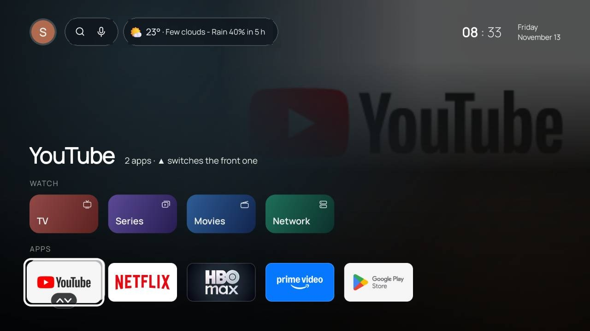

<p align="center">
  
</p>

<h1 align="center">One TV Launcher</h1>

<p align="center">
  <b>A fast, ad-free home screen for Google TV and Android TV.</b><br>
  Your apps, your weather, your alarm clock. No ads or "sponsored" rows.
</p>

<p align="center">
  <a href="../../releases/latest"></a>
  
  
  
  <a href="LICENSE"></a>
</p>

---

The stock Google TV home screen is a billboard with a few apps attached. **One TV Launcher** turns it around: the apps
you actually use come first, and the screen tells you what time it is, whether it will rain, and when your alarm goes
off. It has no ads and no autoplaying trailers, and it doesn't send telemetry anywhere.

It runs every day on a living-room Chromecast with Google TV, so it's built for people sitting on a couch with a
remote, not for a phone with a touchscreen.

## Why you'll like it

| | |
|---|---|
| ⚡ **Fast** | Built with plain Android Views and compiled ahead of time, with no Compose or WebView. Coming back to the home screen takes about 45 ms on a Chromecast (the old version took 73 ms), so it keeps up with the remote. |
| 🧹 **Clean** | Your apps in the order *you* use them. Group apps into stacks, hide the ones you don't want, and turn off the factory bloat. |
| 🌦️ **Weather** | Current conditions from the nearest airport's weather report, plus a rain forecast that combines three weather models. The day/night icon follows the real sunset, twilight included. |
| ⏰ **Alarm clock** | Your TV can wake you up. It turns the TV on over HDMI-CEC, raises the volume gradually, and supports snooze. If the TV was off when an alarm was due, it tells you that alarm was missed. |
| 📺 **TV & movies built in** | Bring your own IPTV account (Xtream Codes or M3U) and get a live channel guide, movies and series with the ratings and synopses you see while browsing, plus Plex, Jellyfin, Emby, SMB, WebDAV and UPnP shares on your network. |
| 🏠 **Smart home** | Home Assistant on your TV: switch lights and scenes with the remote, see the doorbell camera on screen, and let the TV tell Home Assistant what's playing. |
| 🔒 **Yours** | Parental PIN, bedtime limits, a guest mode, and encrypted backups protected by your own password. |

## A quick tour

<table>
<tr>
<td width="50%"><br><b>Home.</b> A search and voice bar, the weather, and your apps. Stack apps you use together (YouTube + YouTube Music) and press ▲ to switch which one is in front.</td>
<td width="50%"><br><b>Forecast.</b> Press OK on the weather: 24 hours, a rain chart, 9 days, air quality, the sun and the moon.</td>
</tr>
</table>

### Everything it can do

<details open>
<summary><b>Home screen</b></summary>

- Clock, date, weather and moon phase, laid out on a fixed grid so nothing jumps around.
- Background art follows the app or movie you have selected, with its rating, year and synopsis.
- Stacks, hidden apps, a manual order or "most used first", and a simple mode with large cards that reads app names aloud.
- Themes: *Live sky* (the actual sky right now, with the sun, moon, clouds and stars), *Gallery* (a public-domain
  painting from the Met every day), *Astrolabe* and *Dark*.
- Hold **HOME** for a quick panel with Wi-Fi, Bluetooth, the sleep timer, screensaver, audio output, alarm, guest mode and notifications.
- The Google Assistant and Gemini keep working. The voice button still reaches them.
</details>

<details>
<summary><b>Clock, alarms & routines</b></summary>

- Alarms with their own sounds, a volume ramp and snooze. The TV turns itself on to ring.
- Sleep timer, a "gentle shutdown" that dims the screen and lowers the volume first, and auto-off when everyone leaves the house.
- Routines that run things at a set time, scenes, reminders, and messages on screen.
- Calendar: your Google Calendar on the TV.
</details>

<details>
<summary><b>Screensaver</b></summary>

- A large clock with the weather and the day's forecast. It moves slowly so it doesn't burn into the screen.
- A photo frame for your own pictures, plus a family board.
- Replaces the stock screensaver and uses about 59 MB less memory.
</details>

<details>
<summary><b>Live TV, movies & series</b></summary>

- An IPTV player for your Xtream Codes or M3U playlist: a channel guide, catch-up, favorites, and blocking for channels and categories.
- Movies and series with posters, ratings and "continue watching", resuming where you stopped.
- Audio language preference (original + subtitles, or dubbed), remembered per title.
- Online subtitles from OpenSubtitles.
- Network media from Plex, Jellyfin, Emby, SMB, WebDAV and UPnP/DLNA.
</details>

<details>
<summary><b>Control from your phone or PC</b></summary>

- **Web panel** on your home network (`http://<tv-ip>:8080`), protected by a PIN: install and remove apps,
  manage permissions, transfer files, see the TV screen live, press remote keys, type text, and download or restore backups.
- **Claude over the internet** (optional): a built-in [MCP](https://modelcontextprotocol.io) server through a Tailscale tunnel,
  so an AI assistant can check the weather on the TV, set an alarm, open an app or tell you what's playing.
  It's off until you turn it on, and you can turn it off at any time.
- Wake-on-LAN for your PC and UniFi presence.
</details>

<details>
<summary><b>Smart home (Home Assistant)</b></summary>

- Turn lights, plugs, fans, covers, scenes and scripts on or off from the couch, from the web panel, or by asking Claude.
- The TV reports itself to Home Assistant (`sensor.tv_<name>`: on or asleep, the app in front, what's playing), so automations like "movie paused → dim the lights" are easy.
- When the doorbell rings, the camera snapshot pops up over whatever you're watching.
- Talks directly to your server on your network, with no cloud in between. The token is encrypted on the TV. Setup: [docs/home-assistant.md](docs/home-assistant.md).
</details>

<details>
<summary><b>Network & privacy</b></summary>

- Private DNS (DNS over TLS) picker, with an automatic rollback if the new server doesn't answer.
- A per-app DNS log and internet usage per app, kept on the TV for 7 days.
- Wi-Fi quality colored by signal, latency and link speed. One-tap speed test.
- No analytics and no tracking. Crash reports stay on the TV unless *you* send them.
</details>

<details>
<summary><b>Takes care of itself</b></summary>

- Overnight maintenance: clears caches, repairs permissions and keeps alarms scheduled.
- Automatic, encrypted backup every night (PBKDF2 + AES-GCM, with your password).
- Updates itself from GitHub Releases. Only APKs signed with the project key are accepted.
- System updates install only at night (3 to 5 am), so they don't interrupt a movie.
</details>

## Install

You need a **Google TV / Android TV** device. It's tested daily on a Chromecast with Google TV (Android 14). Download the APK from
[**Releases**](../../releases/latest):

| File | For |
|---|---|
| `one-tv-launcher.apk` | 32-bit devices (`armeabi-v7a`), e.g. **Chromecast with Google TV** |
| `one-tv-launcher-arm64.apk` | 64-bit devices (`arm64-v8a`) |

1. **Install the APK.** Use any sideloading app (e.g. *Downloader*), or run `adb install one-tv-launcher.apk`.
2. **Open it.** A welcome wizard walks you through each step with the remote. You don't need a computer:
   1. Turn on the launcher's remote-key service (accessibility).
   2. Turn on Developer options. The wizard shows you where.
   3. Pair the launcher with the TV. It reads the pairing code from the screen for you.
   4. *(Optional)* Make it the **device owner**. This lets it pin the HOME button, hide apps and protect itself from
      "Force stop".
3. Press **HOME**. Done.

> [!IMPORTANT]
> **The device owner step is optional, and only a factory reset undoes it.** Google turns off for a few seconds while
> it's applied; your Google account stays, but any extra user profiles on the TV are removed. Everything else works
> without it. Details: [docs/device-owner.md](docs/device-owner.md).

> [!NOTE]
> Google's own launcher stays installed. Gemini, voice search results and Google's notifications panel live inside it.
> One TV Launcher keeps HOME for itself and lets Google handle the rest.

## Build it yourself

```bash
git clone https://github.com/ChrnX0/one-tv-launcher.git
cd one-tv-launcher
cp pessoal.properties.exemplo pessoal.properties   # optional: your city, coordinates and favorite apps
./gradlew assembleRelease                           # JDK 21 + Android SDK 36
```

- Kotlin 2.2, AGP 8.11, Gradle 8.14. Views only, with no XML layouts and no Compose.
- The Tailscale tunnel (`tunel/`, Go) is built into the APK if Go is installed. Without Go, the APK is built without it.
- Unit tests run on the plain JVM: `./gradlew testReleaseUnitTest`.
- Release builds are signed with `ASSINATURA_ARQUIVO` / `ASSINATURA_SENHA` / `ASSINATURA_ALIAS`. Without them, Gradle uses the debug key.

> The code comments are in Brazilian Portuguese, and the app speaks both **English** and **Portuguese**. It follows the
> TV's language.

## Under the hood

```
app/src/main/kotlin/…/
├─ MainActivity, Grade, DesenhoHome   home screen and its fixed grid
├─ PrivilegioDO, VirarDono            device owner: hide apps, pin HOME, permissions
├─ AdbConnectionManager, Guardiao…    built-in ADB client: the TV pairs with itself (no PC, no Shizuku)
├─ AutorizaShizukuService             accessibility: remote keys, HOME long-press, window watcher
├─ Player*, Vod*, Plex, Jellyfin…     IPTV, movies, series and network media
├─ Painel*                            web panel (HTTP server, PIN, PBKDF2, rate limiting)
├─ Mcp*, TunelTailscale               MCP server + Tailscale tunnel (userspace, no VPN slot used)
└─ Despertador, Protetor*, Previsao…  alarm clock, screensaver, weather
```

Security was designed in from the start. The web panel only answers on the local network, checks the Host and Origin
headers, uses HttpOnly cookies, and asks for the PIN again before anything destructive. MCP uses OAuth 2.1 with PKCE.
Secrets are encrypted with the Android Keystore. Backups are encrypted with your password.

## Contributing

Bug reports, ideas and pull requests are welcome: see [CONTRIBUTING.md](CONTRIBUTING.md). Found a security problem?
Please report it privately, as described in [SECURITY.md](SECURITY.md). What changed in each version: [CHANGELOG.md](CHANGELOG.md).

## License

One TV Launcher is free software, released under the [GNU General Public License v3.0](LICENSE). You can use, study,
change and share it; if you distribute a modified version, you must publish its source under the same license.
Third-party code keeps its own license (see Credits below).

## Credits

The fonts, icons, libraries and data sources all come with their licenses in
[`app/src/main/assets/licencas.txt`](app/src/main/assets/licencas.txt). You can also read them on the TV in
*Settings → Licenses*. The weather data comes from [Open-Meteo](https://open-meteo.com) and METAR reports, and the paintings come from
[The Met Open Access](https://www.metmuseum.org/about-the-met/policies-and-documents/open-access).

---

<p align="center"><sub>Not affiliated with Google. "Google TV", "Android TV" and "Chromecast" are trademarks of Google LLC.</sub></p>
